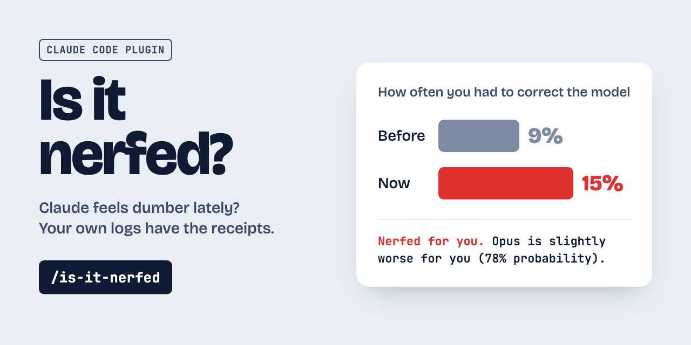

# is-it-nerfed



Everyone argues about whether Claude got worse. This Claude Code plugin answers the question
for **you**, from your own session logs, not from vibes on X.

It samples the prompts you typed and asks Sonnet subagents one question for each: did you have
to correct the model because the model made an error? It then compares the last two weeks with
an earlier window and gives you a verdict.

## Install

```
claude plugin marketplace add resitaydin/is-it-nerfed && claude plugin install is-it-nerfed@is-it-nerfed
```

## Run

In any Claude Code session, type `/is-it-nerfed`, or just ask "did Claude get dumber?".
Claude shows the token cost and asks before it starts. You get 7 lines:

```
Verdict:        Nerfed for you. Opus 5.5 is slightly worse for you (78% probability).
Model mistakes: 15 of 160 prompts before (9%, Sep 24–28), 26 of 170 now (15%, Sep 30–Oct 4).
Agent behavior: Interrupts 3.2× as often as before.
Your setup:     CLAUDE.md changed 2×.
Claude Code:    2.1.285: default effort lowered to medium. This can explain the drift.
Confidence:     Medium. 330 prompts over 10 days.
Report:         ~/.claude/is-it-nerfed/report-2026-10-04.html
```

The HTML report adds a chart, the Claude Code releases, and the status incidents in that time.

## Privacy

- It reads your session logs in `~/.claude*/projects/` and writes only to `~/.claude/is-it-nerfed/`.
- Your prompts go only to the Sonnet subagents in your own Claude Code session.
- It makes two public GET requests that carry no data from you: the
  [Claude Code changelog](https://raw.githubusercontent.com/anthropics/claude-code/main/CHANGELOG.md)
  and the [Claude status incidents](https://status.claude.com/api/v2/incidents.json).

## Cost

About 1.4k Sonnet tokens per prompt, on your own Claude plan. Each run labels up to 600
prompts (about 0.9M tokens). A run does not reuse old labels: one judge labels both windows,
so a change of the judge cannot look like a change of the model.

## Tip: keep more history

Claude Code deletes session logs after 30 days. The baseline is the oldest part of the logs
that remain. For a better baseline, add this to `~/.claude/settings.json`:

```json
{ "cleanupPeriodDays": 365 }
```

## Uninstall

```
claude plugin uninstall is-it-nerfed@is-it-nerfed
claude plugin marketplace remove is-it-nerfed
rm -rf ~/.claude/is-it-nerfed
```

## License

[MIT](LICENSE)
